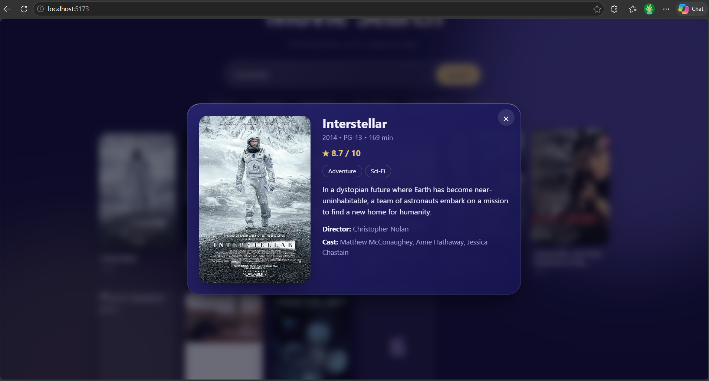
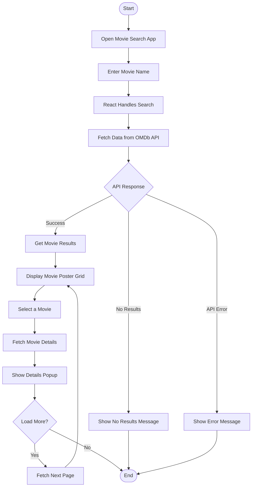

<div align="center">

# 🎬 Movie Search

**Search any movie. See its poster, rating, cast and story, instantly.**

[](https://shivam-movie-search.netlify.app)


<br />



</div>

---

## 🔀 Application Flow



--- 
## ✨ Features

| | |
|---|---|
| 🔎 **Instant search** | Type a movie name or tap a suggestion chip |
| 🖼️ **Poster grid** | Smooth card animations and a clean, responsive layout |
| ⏳ **Loading skeletons** | Shimmer placeholders while the data loads |
| 📄 **Details popup** | Rating, genre, plot, director and cast in one place |
| ➕ **Load more** | Fetch more results page by page |
| ⚠️ **Friendly errors** | Clear messages for no results, bad key or no internet |
| 📱 **Responsive** | Works on phones, tablets and laptops |
| 🪟 **Glass design** | Frosted-glass look with soft glowing backgrounds |

## 🛠️ Built with

- **React** for the interface, using hooks like `useState`, `useEffect` and `useRef`
- **Vite** for fast development and builds
- **OMDb API** for movie data
- **Plain CSS** for all styling, animations and the glass effect

## 🧠 What I learned

- Fetching data from a real API with `fetch` and `async/await`
- Handling loading, error and empty states in the UI
- Cleaning up effects so old requests never overwrite new ones
- Splitting the app into small reusable components
- Keeping secret keys out of the code with environment variables

## 🚀 Run it locally

1. **Clone the project**
   ```bash
   git clone https://github.com/shivamkumar0097/movie-search.git
   cd movie-search
   ```

2. **Get a free API key** from [omdbapi.com](https://www.omdbapi.com/apikey.aspx) and activate it from your email.

3. **Create a `.env` file** in the project root:
   ```env
   VITE_OMDB_KEY=your_key_here
   ```

4. **Install and start**
   ```bash
   npm install
   npm run dev
   ```

Then open `http://localhost:5173`.

## 🗂️ Project structure

```
movie-search/
├── src/
│   ├── App.jsx      # search, grid and popup
│   └── App.css      # all styles and animations
├── .env             # your API key (not uploaded to GitHub)
└── index.html
```

## 👋 About me

I'm **Shivam Kumar**, a BCA student and frontend developer learning React by building real projects.

[](https://github.com/shivamkumar0097)
[](https://www.linkedin.com/in/shivamkumar0097)
[](mailto:shivamkr8135@gmail.com)

<div align="center">

⭐ If you liked this project, give it a star!

</div>
